<h1 align="center">Hi, I'm Jitendra Gopi Bellamkonda 👋</h1>

<h3 align="center">
  Java Developer · Software Engineer · DevOps Enthusiast
</h3>

  Building backend systems, full-stack applications, and automated delivery pipelines.

  

  
  
  
  

  <a href="#about">About</a> &nbsp;·&nbsp;
  <a href="#technical-skills">Technical Skills</a> &nbsp;·&nbsp;
  <a href="#featured-projects">Projects</a> &nbsp;·&nbsp;
  <a href="#certifications">Certifications</a> &nbsp;·&nbsp;
  <a href="#github-activity">GitHub Activity</a> &nbsp;·&nbsp;
  <a href="#connect">Connect</a>

---

## About

I'm a **Computer Science and Engineering graduate from KL University**, with a **9.47/10 CGPA** and a focus on **Java development, backend engineering, and software delivery automation**.

I build applications using **Java, Spring Boot, REST APIs, React, and MySQL**, and work with **Git, Jenkins, and AWS** for version control, CI/CD, and cloud workflows. My project work also includes **machine learning-based CI/CD failure prediction using Random Forest and SHAP**.

- **Education:** B.Tech in Computer Science and Engineering · KL University · 2022–2026
- **Core Stack:** Java · Spring Boot · React · MySQL
- **Delivery & Cloud:** Git · GitHub · Jenkins · AWS
- **AI & ML:** Python · Machine Learning · Random Forest · SHAP

> **My approach:** Write clean code. Automate repetitive work. Build with purpose.

---

## Technical Skills

  <samp>BACKEND ENGINEERING / FULL-STACK DEVELOPMENT / DEVOPS / APPLIED ML</samp>

  Expand each panel to view my capabilities.

<table width="100%">
  <tr>
    <td width="50%" valign="top">
      <h3>01 &nbsp; Programming Languages</h3>
      

        
      

      
<strong>Java · C · Python · JavaScript</strong>

      

        
<strong>View capabilities</strong>

         
        <ul>
          <li>Java application development and object-oriented programming</li>
          <li>Programming and problem-solving with C</li>
          <li>Python scripting and machine learning implementation</li>
          <li>JavaScript application logic and frontend development</li>
        </ul>
      

    </td>
    <td width="50%" valign="top">
      <h3>02 &nbsp; Backend Engineering</h3>
      

        
      

      
<strong>Spring Boot · Maven · REST APIs</strong>

      

        
<strong>View capabilities</strong>

         
        <ul>
          <li>Backend application development with Java and Spring Boot</li>
          <li>REST API development and application integration</li>
          <li>Dependency management and application builds with Maven</li>
          <li>Authentication and role-based application functionality</li>
        </ul>
      

    </td>
  </tr>

  <tr>
    <td width="50%" valign="top">
      <h3>03 &nbsp; Frontend Development</h3>
      

        
      

      
<strong>HTML5 · CSS3 · JavaScript · React · Vite</strong>

      

        
<strong>View capabilities</strong>

         
        <ul>
          <li>Component-based interfaces with React</li>
          <li>Reusable frontend components and organized application structure</li>
          <li>Responsive layouts and visual styling with HTML and CSS</li>
          <li>Frontend development and build workflows with Vite</li>
        </ul>
      

    </td>
    <td width="50%" valign="top">
      <h3>04 &nbsp; Database Engineering</h3>
      

        
      

      
<strong>SQL · MySQL · Relational Databases</strong>

      

        
<strong>View capabilities</strong>

         
        <ul>
          <li>SQL querying and application data management</li>
          <li>Relational database concepts and data organization</li>
          <li>MySQL integration with backend applications</li>
          <li>Database-backed functionality for full-stack projects</li>
        </ul>
      

    </td>
  </tr>

  <tr>
    <td width="50%" valign="top">
      <h3>05 &nbsp; DevOps &amp; Cloud</h3>
      

        
      

      
<strong>Git · GitHub · Jenkins · CI/CD · AWS</strong>

      

        
<strong>View capabilities</strong>

         
        <ul>
          <li>Version control and collaborative development with Git and GitHub</li>
          <li>Jenkins pipeline configuration and automated builds</li>
          <li>CI/CD workflows and pipeline metrics analysis</li>
          <li>AWS cloud concepts and services</li>
        </ul>
      

    </td>
    <td width="50%" valign="top">
      <h3>06 &nbsp; Artificial Intelligence &amp; ML</h3>
      

        
      

      
<strong>AI · Machine Learning · Random Forest · SHAP</strong>

      

        
<strong>View capabilities</strong>

         
        <ul>
          <li>Artificial intelligence and machine learning fundamentals</li>
          <li>Predictive modeling with Random Forest</li>
          <li>CI/CD build-failure prediction using pipeline metrics</li>
          <li>Model interpretability and feature analysis with SHAP</li>
        </ul>
      

    </td>
  </tr>
</table>

  CODE → BUILD → INTEGRATE → AUTOMATE → IMPROVE

---

## Featured Projects

### 01 / CampusConnect-AIOps
#### Predictive CI/CD Failure Analysis

An academic DevOps capstone combining **Spring Boot, Jenkins, and machine learning** to analyze pipeline metrics and predict potential build and deployment failures.

- Developed a **Java Spring Boot application** with Maven.
- Configured a **Jenkins CI/CD pipeline** for automated builds.
- Analyzed build duration, test failures, code changes, and dependency updates.
- Implemented a **Random Forest prediction prototype** for build-failure analysis.
- Used **SHAP** to examine feature importance and model predictions.

**Stack:** `Java` `Spring Boot` `Maven` `Jenkins` `Python` `Random Forest` `SHAP` `MySQL`

---

### 02 / CampusConnect
#### Placement Management Portal

A centralized placement management application connecting **students, recruiters, and administrators** through role-oriented workflows.

- Developed application components for all three user roles.
- Built backend functionality using **Java and Spring Boot**.
- Developed **REST APIs** for application operations.
- Integrated **MySQL** for persistent data management.
- Implemented authentication and role-oriented application components.

**Stack:** `Java` `Spring Boot` `REST APIs` `MySQL` `React` `JavaScript` `HTML` `CSS`

---

### 03 / ArtVista
#### Online Art Gallery Platform

A team-based full-stack project for showcasing and exploring artwork through a digital gallery.

- Developed frontend components using **React**.
- Contributed to backend development with **Spring Boot**.
- Integrated **MySQL** for application data management.
- Collaborated across frontend and backend implementation.

**Stack:** `React` `Java` `Spring Boot` `MySQL` `JavaScript` `HTML` `CSS`

---

### 04 / Personal Portfolio
#### Developer Portfolio Website

A React-based portfolio presenting my **projects, technical skills, education, and development journey**.

- Built the frontend using **React and reusable components**.
- Created dedicated About, Education, Skills, Projects, and Contact sections.
- Styled layouts and visual elements using **CSS**.
- Used **Vite** for development and production builds.

**Stack:** `React` `JavaScript` `HTML5` `CSS3` `Vite`

---

## Certifications

- **AWS Certified Cloud Practitioner**
- **Red Hat Certified Enterprise Application Developer — EX183**
- **NPTEL — Programming in Java**

### Coding & Academic Achievements

- **9.47/10 CGPA** — B.Tech, Computer Science and Engineering
- **CodeChef Diamond 100-Day Badge**
- **Consistent problem-solving practice** on LeetCode and CodeChef

---

## GitHub Activity

  <samp>CONTRIBUTIONS / REPOSITORY ACTIVITY / LANGUAGE DISTRIBUTION</samp>

  
  

  

  Language distribution reflects repository code, not proficiency levels.

---

## Connect

  Interested in my projects or technical work? Explore my repositories and coding profiles.

  
  &nbsp;
  
  &nbsp;
  

---

  <strong>Dream big. Write clean code. Build with purpose.</strong>

  Thanks for visiting — Jitendra Gopi Bellamkonda

